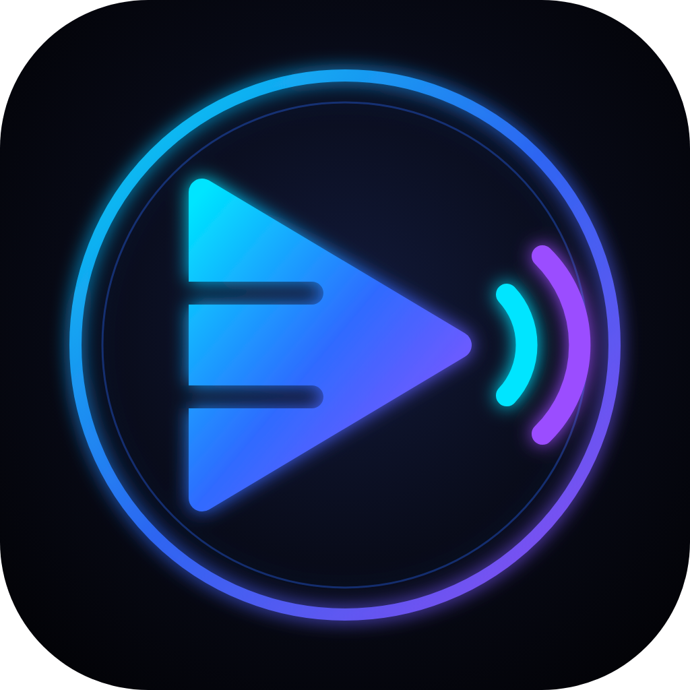

<h1 align="center">ELARCAST</h1>

<b>MULTIMEDIA PLAYER</b> Creación: Elar Castro con la IA

---

ELARCAST es un reproductor multimedia para Android: música del celular, videos, TV en vivo y radios por internet en una sola app.

## Funciones

- **Música del celular** organizada por artista y álbum, con listas de reproducción.
- **Videos** a pantalla completa.
- **TV en vivo**: canales abiertos por internet por país, idioma y categoría, con guía de programación.
- **Radios por internet** por país y género, con favoritos.
- **Ecualizador** de 10 bandas con ajustes predefinidos y visualizaciones.
- Sigue sonando en **segundo plano**, con controles en la notificación y la pantalla de bloqueo.
- Temas de color, incluido el tema **Elarcast** (negro, azul eléctrico, cian y violeta).

## Descarga

La APK se compila sola con GitHub Actions en cada cambio y queda en **Releases › ELARCAST Android (pruebas)**.
Requiere Android 8.0 o superior. Si ya tenías la versión anterior, se instala encima y conserva tus listas y ajustes.

## Estructura

| Carpeta / archivo | Contenido |
|---|---|
| `android/` | Proyecto de Android (Gradle) |
| `elarcast.html` | Interfaz de la app (se copia al APK al compilar) |
| `lib/`, `VT323-Regular.ttf` | Reproductor HLS y fuente de la pantalla LCD |
| `branding/` | Logotipo, iconos y recursos para Google Play |
| `.github/workflows/android.yml` | Compilación automática del APK |

## Compilar

GitHub Actions lo hace solo. A mano: JDK 17, Android SDK 35 y Gradle 8.10.2; copiar `elarcast.html`, `lib/hls.min.js` y `VT323-Regular.ttf` a `android/app/src/main/assets/www/` (como hace el flujo) y ejecutar `gradle assembleRelease` dentro de `android/`.
