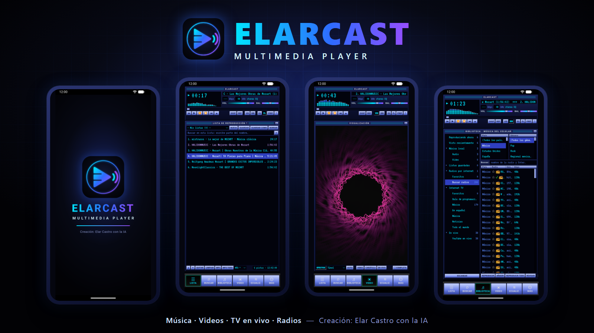
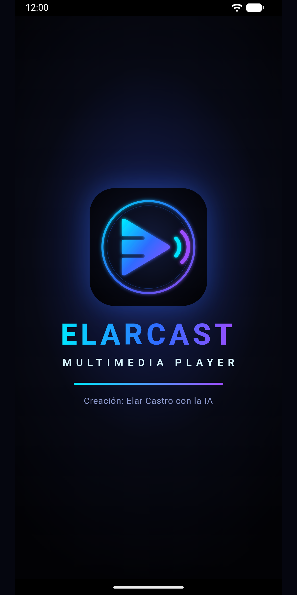
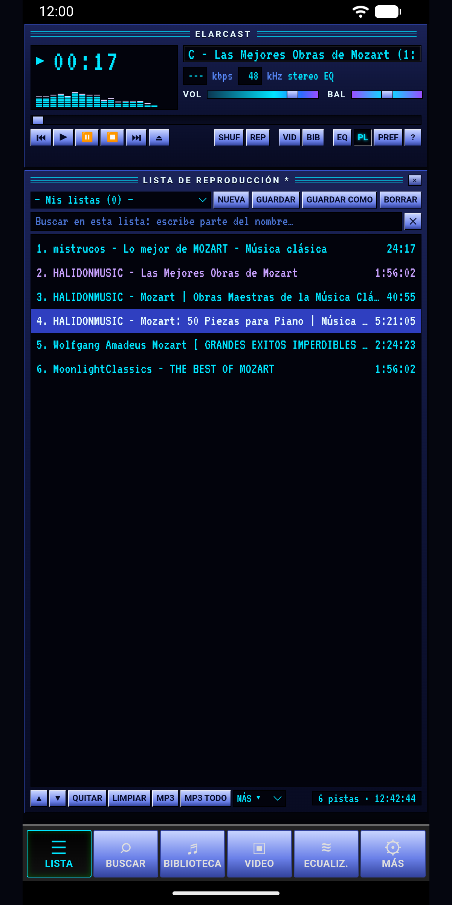
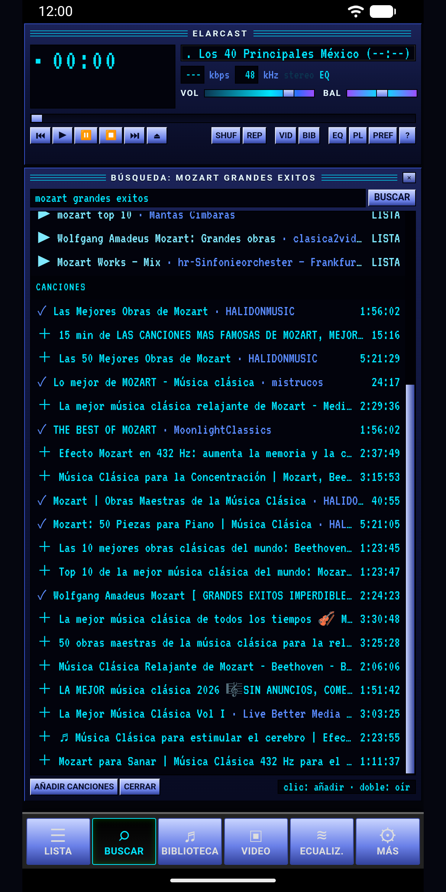
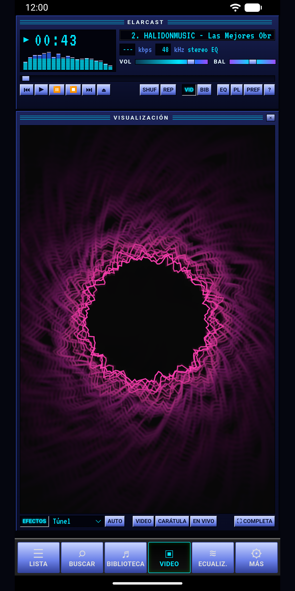
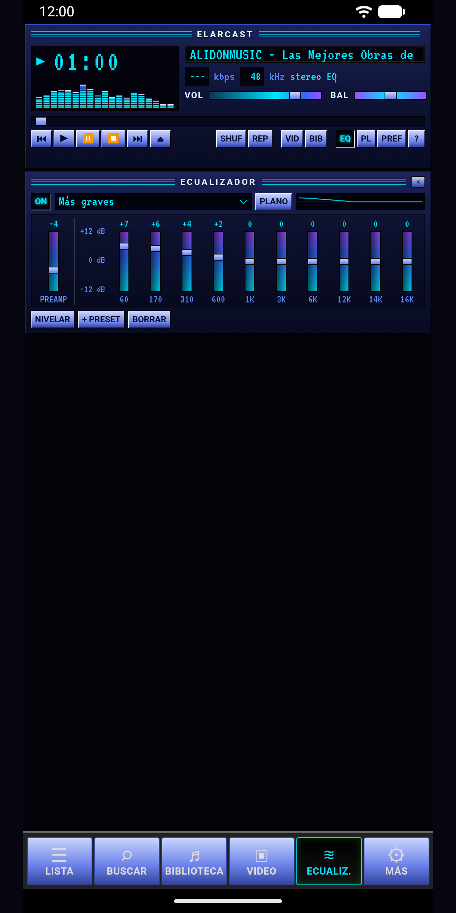
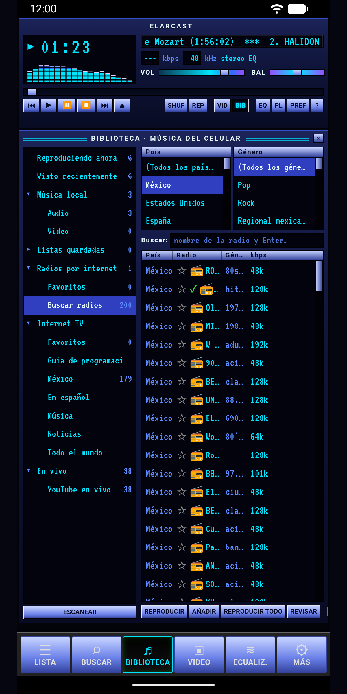
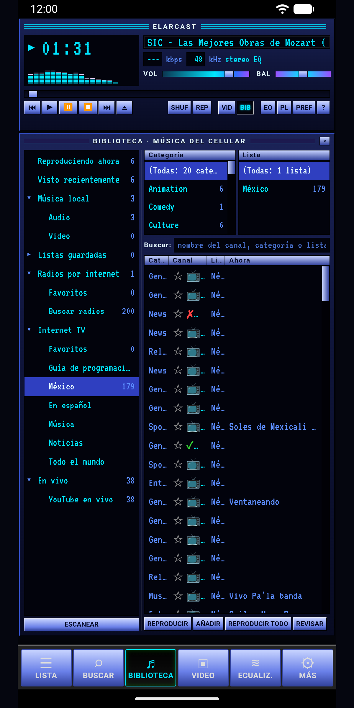
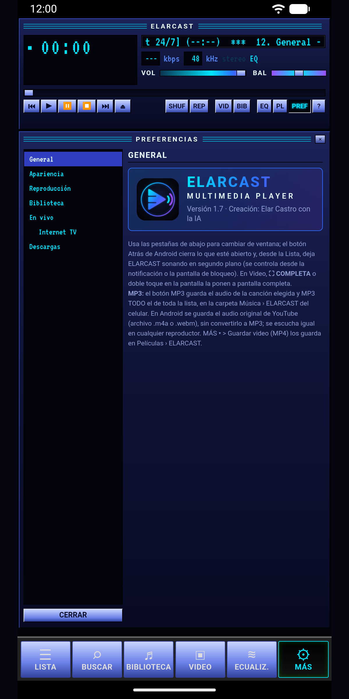

  

  
  
  

  <a href="https://github.com/ElarCastro/ELARCAST/releases/latest"><b>⬇️ Descargar ELARCAST para Android</b></a>

<b>Música · Videos · TV en vivo · Radios</b> — todo en una sola app. 
Creación: Elar Castro con la IA

---

## ✨ Funciones

| | |
|---|---|
| 🎵 **Tu música** | La música del celular ordenada por artista y álbum, con listas de reproducción que puedes guardar. |
| 🔎 **Buscar** | Encuentra canciones y videos y añádelos a tu lista con un toque. |
| 📺 **TV en vivo** | Canales abiertos por internet de varios países, por idioma y categoría, con guía de programación. |
| 📻 **Radios** | Emisoras de todo el mundo por país y género; guarda tus favoritas con ☆. |
| 🌈 **Visualizaciones** | Efectos que bailan con la música y videos a pantalla completa (giran a horizontal). |
| 🎚️ **Ecualizador** | 10 bandas con ajustes para Rock, Pop, Latino, Más graves, Voz y más, y nivelador de volumen. |
| 🔒 **Segundo plano** | Sigue sonando con la pantalla apagada; controles en la notificación y la pantalla de bloqueo. |
| 🎨 **Temas** | Tema **Elarcast** en negro, azul eléctrico, cian y violeta, y otros siete temas de color. |

## 📱 Así se ve

<table>
  <tr>
    <td align="center"> Inicio</td>
    <td align="center"> Lista de reproducción</td>
    <td align="center"> Buscar</td>
    <td align="center"> Visualizaciones</td>
  </tr>
  <tr>
    <td align="center"> Ecualizador</td>
    <td align="center"> Radios por internet</td>
    <td align="center"> TV en vivo</td>
    <td align="center"> Acerca de</td>
  </tr>
</table>

## ⬇️ Instalación

1. En tu celular, abre **[Releases](https://github.com/ElarCastro/ELARCAST/releases/latest)** y descarga **`ELARCAST-1.5-android.apk`**.
2. Abre el archivo descargado.
3. Como no viene de Google Play, Android pedirá **«Permitir instalar apps de esta fuente»**: actívalo para tu navegador o explorador de archivos y vuelve atrás.
4. Pulsa **Instalar** y abre **ELARCAST**.

> **¿Ya tenías RetroAmp para Android?** Instala ELARCAST encima, sin desinstalar: es la misma app con nombre nuevo y **conservas tus listas, favoritos y ajustes**.

**Requisitos:** Android 8.0 o superior y conexión a internet para buscar, ver TV y escuchar radios.

## ❓ Preguntas frecuentes

<b>¿Dónde quedan las canciones que descargo?</b>

Los botones **MP3** y **MP3 TODO** guardan el audio en **Música › ELARCAST** y los videos en **Películas › ELARCAST**. Los encuentras con tu explorador de archivos o tu app de música.

<b>Un canal de TV o una radio no se reproduce</b>

Los canales y emisoras son transmisiones públicas de terceros y a veces dejan de emitir. ELARCAST te avisa cuando uno no está disponible; elige otro. En la Biblioteca, **REVISAR** marca cuáles están transmitiendo.

<b>¿Necesito una cuenta?</b>

No. ELARCAST funciona sin registrarte.

<b>¿Cómo pongo un video a pantalla completa?</b>

En la pestaña **Video**, pulsa **⛶ COMPLETA** o toca dos veces la pantalla. Para salir, usa **Atrás** o vuelve a tocar dos veces.

## 🛠️ Para desarrolladores

Estructura del proyecto y compilación

| Carpeta / archivo | Contenido |
|---|---|
| `android/` | Proyecto de Android (Gradle) |
| `elarcast.html` | Interfaz de la app (se copia al APK al compilar) |
| `lib/`, `VT323-Regular.ttf` | Reproductor HLS y fuente de la pantalla LCD |
| `branding/` | Logotipo, iconos, capturas y recursos para Google Play |
| `.github/workflows/android.yml` | Compilación automática del APK |

GitHub Actions compila la APK en cada cambio y la deja en **Releases › ELARCAST Android (pruebas)**.
A mano: JDK 17, Android SDK 35 y Gradle 8.10.2; copia `elarcast.html`, `lib/hls.min.js` y `VT323-Regular.ttf` a `android/app/src/main/assets/www/` y ejecuta `gradle assembleRelease` dentro de `android/`.

---

   
  <b>ELARCAST · MULTIMEDIA PLAYER</b> 
  Creación: Elar Castro con la IA

